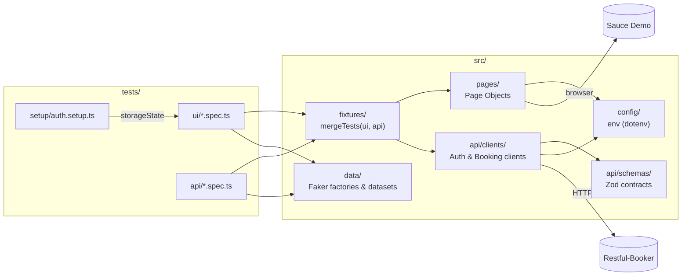
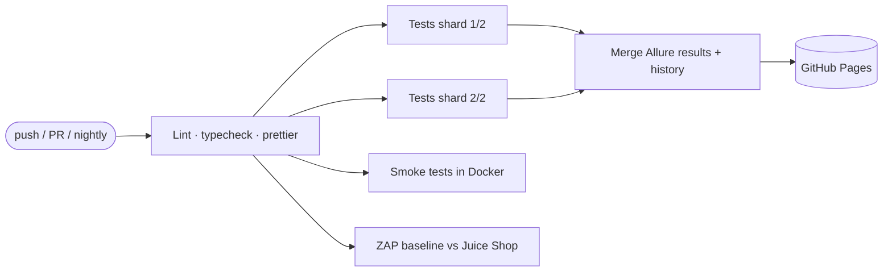

# Playwright Automation Framework

[](https://github.com/<your-user>/playwright-automation-framework/actions/workflows/ci.yml)
[](https://<your-user>.github.io/playwright-automation-framework/)


A production-style test automation framework built with **Playwright + TypeScript** that covers
**REST API** and **end-to-end UI** testing in one codebase, runs in parallel and sharded on
**GitHub Actions**, publishes an **Allure** report to **GitHub Pages**, runs an **OWASP ZAP**
baseline security scan, and ships as a **Docker** image.

| Layer    | System under test                                                         | What is covered                                                   |
| -------- | ------------------------------------------------------------------------- | ----------------------------------------------------------------- |
| UI (E2E) | [Sauce Demo](https://www.saucedemo.com)                                   | Login (data-driven negatives), sorting, cart, checkout and totals |
| API      | [Restful-Booker](https://restful-booker.herokuapp.com/apidoc)             | Auth, full CRUD, filtering, contract (schema) validation, authZ   |
| Security | [OWASP Juice Shop](https://owasp.org/www-project-juice-shop/) (container) | ZAP passive baseline scan with a tuned rules file                 |

---

## Architecture



### CI/CD pipeline



### Design decisions

- **Page Object Model** – every page extends `BasePage`; locators are defined once using
  `data-test` attributes (`testIdAttribute`), so specs read as business steps.
- **Custom fixtures** – Page Objects and API clients are injected through `test.extend`, and the UI
  and API fixtures are combined with `mergeTests`, so one `test` import serves both layers.
- **Worker-scoped auth token** – the API token is created once per worker, not per test.
- **Self-cleaning test data** – the `createdBooking` fixture creates a booking before the test and
  deletes it in teardown, keeping tests independent on a shared public API.
- **Session reuse** – a `setup` project logs in once and saves `storageState`; UI projects depend on
  it, which removes the login step from every E2E test.
- **Contract testing** – every API response is validated with **Zod** schemas; a contract break
  fails with a readable diff instead of an `undefined` further down.
- **Data-driven tests** – login errors, sort orders, baskets and missing checkout fields are
  parametrised datasets; random but valid data comes from **Faker** factories.
- **Tagging** – `@smoke`, `@regression`, `@api`, `@ui`, `@security` enable targeted runs.
- **Reliability** – `fullyParallel`, retries on CI only, trace/video/screenshot kept on failure.

## Project structure

```
├── .github/workflows/ci.yml   # lint → sharded tests → Allure → Pages, Docker, ZAP
├── .zap/rules.tsv             # ZAP rule tuning (IGNORE / WARN / FAIL)
├── src/
│   ├── api/clients/           # BaseClient (schema parsing), AuthClient, BookingClient
│   ├── api/schemas/           # Zod contracts + inferred TypeScript types
│   ├── config/                # env.ts (dotenv + defaults), paths.ts
│   ├── data/                  # users, products, Faker factories
│   ├── fixtures/              # ui.fixture, api.fixture, index (mergeTests)
│   └── pages/                 # BasePage, LoginPage, InventoryPage, CartPage, CheckoutPage
├── tests/
│   ├── api/                   # auth.spec, booking.spec
│   ├── setup/                 # auth.setup (storageState)
│   └── ui/                    # login, inventory, cart, checkout
├── Dockerfile · docker-compose.yml
└── playwright.config.ts       # projects: api, setup, chromium, firefox
```

## Getting started

Requirements: Node 22+, and Java 11+ only if you want to build the Allure report locally.

```bash
npm ci
```

```bash
npx playwright install --with-deps chromium firefox
```

```bash
cp .env.example .env   # optional – defaults point at the public demo apps
```

| Command                 | What it does                                    |
| ----------------------- | ----------------------------------------------- |
| `npm test`              | Full suite (API + Chromium + Firefox)           |
| `npm run test:api`      | API tests only                                  |
| `npm run test:ui`       | UI tests on Chromium and Firefox                |
| `npm run test:smoke`    | Only `@smoke` tests                             |
| `npm run test:security` | Only `@security` (authorization) tests          |
| `npm run lint`          | ESLint (typed rules + eslint-plugin-playwright) |
| `npm run typecheck`     | `tsc` in strict mode                            |
| `npm run allure:serve`  | Build and open the Allure report                |
| `npm run report`        | Open the Playwright HTML report                 |

### Docker

```bash
docker build -t pw-framework .
```

```bash
docker run --rm pw-framework npm run test:smoke
```

Run the ZAP baseline locally against a Juice Shop container (report lands in `zap-report/`):

```bash
docker compose up -d juice-shop && docker compose run --rm zap
```

## Reporting

- **Allure** – published to GitHub Pages on every push to `main`, with trend history kept between
  runs, Epic/Feature/Severity labels, test steps, and screenshots, videos and traces on failure.
- **Playwright HTML report** – uploaded as a workflow artifact for each shard.
- **ZAP** – HTML/JSON/Markdown reports uploaded as the `zap-report` artifact.

## Security testing

- The **ZAP baseline** is a passive scan run only against a local, intentionally vulnerable
  **Juice Shop** container, never against the public demo sites. `.zap/rules.tsv` sets how each
  rule is treated (ignore known false positives, warn on missing security headers).
- **API authorization tests** (`@security`) check that write operations without a token or with a
  forged token are refused with `403`.

## Setting up GitHub Pages

1. Push the repo to GitHub; the first run on `main` creates the `gh-pages` branch.
2. **Settings → Pages → Source:** “Deploy from a branch”, branch `gh-pages`, folder `/ (root)`.
3. Replace `<your-user>` in the badges above.

> When Dependabot bumps `@playwright/test`, update the image tag in the `Dockerfile` to match.

## License

MIT
